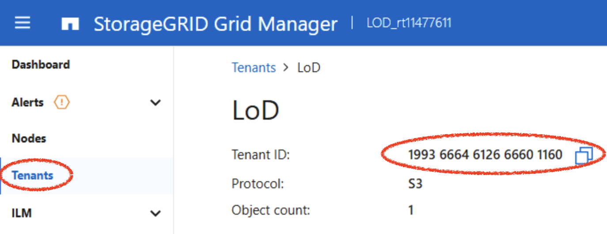
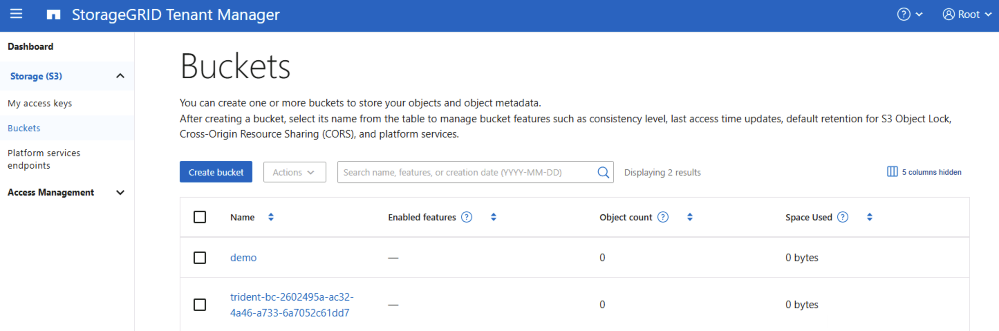

#########################################################################################
# COSI and StorageGRID — Certificates
#########################################################################################

You will learn here how to configure Trident and Kubernetes to interact with StorageGRID using a custom TLS certificate.  
Instead of `insecureSkipVerify: true`, the `TridentObjectStore` trusts your CA through `trustedCACertificate`, and aws-cli verifies TLS with `ca_bundle`.

## A. Generate a certificate and key

On the ubuntu host, create a self-signed certificate that covers the StorageGRID management and S3 endpoints:  
```bash
cd
mkdir ~/certs && cd ~/certs
cat << EOF > san.cnf
[req]
distinguished_name = dn
x509_extensions = v3
prompt = no

[dn]
C = US
ST = NC
L = RTP
O = NetApp
OU = Lab on Demand
CN = *.demo.netapp.com

[v3]
basicConstraints = critical,CA:TRUE
keyUsage = critical,digitalSignature,keyEncipherment,keyCertSign
extendedKeyUsage = serverAuth
subjectAltName = @alt

[alt]
DNS.1 = dc1-adm1.demo.netapp.com
DNS.2 = dc1-g1.demo.netapp.com
DNS.3 = dc2-g2.demo.netapp.com
DNS.4 = *.demo.netapp.com
IP.1 = 192.168.0.80
EOF

# Generate key and cert
openssl req -x509 -newkey rsa:2048 -nodes \
  -keyout sg-key.pem -out sg-cert.pem \
  -days 365 -config san.cnf -extensions v3

openssl x509 -in sg-cert.pem -noout -ext subjectAltName
```

Copy the files to the jumphost if you will upload them from there (for example to the Windows desktop).  
The following must be run from the jumphost, with a Powershell cli for instance:    
```bash
scp root@192.168.0.61:/root/certs/sg-*.pem $HOME/Desktop/
```

## B. Upload the certificate to StorageGRID

### S3 API / load balancer endpoint

As the port **10443** is a load balancer endpoint, in Grid Manager, go to **Configuration > Network > Load balancer endpoints**.
Upload `sg-cert.pem` as the certificate and `sg-key.pem` as the private key.  
If it was not the case, you would upload them to **Configuration > Security > Certificates**, under the **Global** tab, and select the **S3 API certificate**.  


### Management interface

On the **Configuration > Security > Certificates > Global** tab, upload the same `sg-cert.pem` and `sg-key.pem` as the **Management interface** certificate.  
This affects Grid Manager and Tenant Manager, so browsers will show the certificate as untrusted unless you import `sg-cert.pem` into them.

## C. Verify the S3 endpoint with TLS

Configure aws-cli to use your new CA bundle. Use S3 credentials from the LoD tenant (Tenant Manager, or keys you already have for the `demo` bucket):  
```bash
cat << EOF >> ~/.aws/config
[profile default]
endpoint_url = https://dc1-adm1.demo.netapp.com:10443/
region = us-east-1
ca_bundle = ~/certs/sg-cert.pem
EOF

cat << EOF >> ~/.aws/credentials
[default]
aws_access_key_id = <YOUR_ACCESS_KEY>
aws_secret_access_key = <YOUR_SECRET_KEY>
EOF

aws s3 ls
aws s3 ls s3://demo/
touch test.txt
aws s3 cp test.txt s3://demo/test.txt
```

If TLS verification fails, re-check that the certificate was applied to the endpoint you are calling (S3 API or load balancer on port 10443) and that `ca_bundle` points at `~/certs/sg-cert.pem`.

## D. Retrieve the Tenant ID

The lab already comes with a tenant ("LoD") configured and ready to be used.  
You can retrieve its ID by connecting to the Grid Manager (dc1-adm1.demo.netapp.com, root/Netapp1!) in the "Tenants" page:  
<p align="center"></p>

You can also retrieve that information via API calls:  
```bash
# 1. Get a token (single quotes stop bash from interpreting the "!" in the password)
TOKEN=$(curl -sk -X POST "https://dc1-adm1.demo.netapp.com/api/v4/authorize" \
  -H "accept: application/json" -H "Content-Type: application/json" \
  -d '{"username":"root","password":"Netapp1!","cookie":false,"csrfToken":false}' \
  | jq -r .data) && echo $TOKEN

# 2. List the tenant accounts
TENANTS=$(curl -sk -X GET "https://dc1-adm1.demo.netapp.com/api/v4/grid/accounts" -H "accept: application/json" -H "Authorization: Bearer $TOKEN") && echo $TENANTS

# 3. Retrieve the "Lod" Tenant id
TENANTID=$(echo $TENANTS | jq -r '.data[] | select(.name == "LoD") | .id') && echo $TENANTID
```

## E. Trident Object Store with a trusted CA

Encode the certificate and create the secret plus a `TridentObjectStore` that references it:  
```bash
base64 -w 0 ~/certs/sg-cert.pem > ~/certs/sg-cert_base64

cat << EOF | kubectl apply -f -
apiVersion: v1
kind: Secret
metadata:
  name: storagegrid
  namespace: trident
type: Opaque
stringData:
  username: root
  password: Netapp1!
---
apiVersion: trident.netapp.io/v1
kind: TridentObjectStore
metadata:
  name: storagegrid-cert
  namespace: trident
spec:
  objectStoreDriver: storage-grid
  accountId: "$TENANTID"
  managementEndpoint: https://192.168.0.80/
  s3Endpoint: https://dc1-adm1.demo.netapp.com:10443/
  credentials:
    secretName: storagegrid
  labels:
    security: cert
  trustedCACertificate: >-
    $(cat ~/certs/sg-cert_base64)
EOF
```

If all went well, the TOS should be **online**:  
```bash
$ tridentctl get objectstore storagegrid-cert -n trident
┌──────────────────┬────────────────┬──────────────────────────────────────┬────────┐
│       NAME       │ STORAGE DRIVER │                 UUID                 │ STATE  │
├──────────────────┼────────────────┼──────────────────────────────────────┼────────┤
│ storagegrid-cert │ storage-grid   │ bf3f5fab-8da8-40b0-b2c1-1893652f2676 │ online │
└──────────────────┴────────────────┴──────────────────────────────────────┴────────┘
```

TLS for this object store is verified against `trustedCACertificate`.

## F. Kubernetes classes

Create a `BucketClass` that selects the cert-labeled object store, and a `BucketAccessClass` for key-based access (`kubectl apply` is safe if `trident-s3-key` already exists from the keys scenario):  
```bash
cat << EOF | kubectl apply -f -
apiVersion: objectstorage.k8s.io/v1alpha2
kind: BucketClass
metadata:
  name: sg-bucket-class-cert
spec:
  driverName: cosi.trident.netapp.io
  deletionPolicy: Delete
  parameters:
    objectStoreType: "storage-grid"
    selector: "security=cert"
---
apiVersion: objectstorage.k8s.io/v1alpha2
kind: BucketAccessClass
metadata:
  name: trident-s3-key
spec:
  driverName: cosi.trident.netapp.io
  authenticationType: Key
  multiBucketAccess: MultipleBuckets
EOF
```

## G. Bucket Creation

Create a namespace, `BucketClaim`, and `BucketAccess`:  
```bash
cat << EOF | kubectl apply -f -
apiVersion: v1
kind: Namespace
metadata:
  name: cosisg-cert
---
apiVersion: objectstorage.k8s.io/v1alpha2
kind: BucketClaim
metadata:
  name: sg-bucket-claim-cert
  namespace: cosisg-cert
spec:
  bucketClassName: sg-bucket-class-cert
  protocols: ["S3"]
---
apiVersion: objectstorage.k8s.io/v1alpha2
kind: BucketAccess
metadata:
  name: sg-bucket-access-cert
  namespace: cosisg-cert
spec:
  bucketAccessClassName: trident-s3-key
  protocol: S3
  bucketClaims:
    - bucketClaimName: sg-bucket-claim-cert
      accessMode: ReadWrite
      accessSecretName: sg-bucket-creds-cert
EOF
```

Confirm the bound bucket and that the secret was created:  
```bash
kubectl get bucket "$(kubectl get bucketclaim sg-bucket-claim-cert -n cosisg-cert -o jsonpath='{.status.boundBucketName}')" -o json | jq .status

kubectl get secret sg-bucket-creds-cert -n cosisg-cert -o go-template='{{range $k,$v := .data}}{{printf "%s: %s\n" $k ($v | base64decode)}}{{end}}'
```

To verify that the bucket is indeed there, you can connect to the Tenant Manager:  
<p align="center"></p>

## H. Bucket Consumption with aws-cli

Configure a dedicated aws profile that trusts your StorageGRID certificate:  
```bash
export SGBUCKETKEYCERT=$(kubectl get secret sg-bucket-creds-cert -n cosisg-cert -o jsonpath='{.data.COSI_S3_ACCESS_KEY_ID}' | base64 -d)
export SGBUCKETSECRETCERT=$(kubectl get secret sg-bucket-creds-cert -n cosisg-cert -o jsonpath='{.data.COSI_S3_ACCESS_SECRET_KEY}' | base64 -d)
export SGBUCKETIDCERT=$(kubectl get secret sg-bucket-creds-cert -n cosisg-cert  -o jsonpath='{.data.COSI_S3_BUCKET_ID}' | base64 -d)

cat << EOF >> ~/.aws/config
[profile sg-cert]
endpoint_url = https://dc1-adm1.demo.netapp.com:10443/
region = us-east-1
ca_bundle = ~/certs/sg-cert.pem
EOF

cat << EOF >> ~/.aws/credentials
[sg-cert]
aws_access_key_id = $SGBUCKETKEYCERT
aws_secret_access_key = $SGBUCKETSECRETCERT
EOF
```

Upload a file and list the bucket. TLS is verified with `ca_bundle`, so there is no `--no-verify-ssl`:  
```bash
touch test.txt
aws s3 cp test.txt s3://$SGBUCKETIDCERT/test.txt --profile sg-cert
aws s3 ls s3://$SGBUCKETIDCERT/ --profile sg-cert
```

Now that we have validated we can read and write from the bucket, let's try with a pod.

## I. Bucket Consumption in Kubernetes

Create a Secret that holds the CA, then a pod that mounts both that CA and the COSI credentials. `AWS_CA_BUNDLE` points aws-cli at the certificate so the request is verified:  
```bash
cat << EOF | kubectl apply -f -
apiVersion: v1
kind: Secret
metadata:
  name: sg-ca
  namespace: cosisg-cert
type: Opaque
data:
  sg-cert.pem: $(base64 -w 0 ~/certs/sg-cert.pem)
---
apiVersion: v1
kind: Pod
metadata:
  name: sg-bucket-client
  namespace: cosisg-cert
spec:
  restartPolicy: Never
  containers:
    - name: aws-cli
      image: amazon/aws-cli:latest
      command: ["sleep", "infinity"]
      envFrom:
        - secretRef:
            name: sg-bucket-creds-cert
      env:
        - name: AWS_ACCESS_KEY_ID
          valueFrom:
            secretKeyRef:
              name: sg-bucket-creds-cert
              key: COSI_S3_ACCESS_KEY_ID
        - name: AWS_SECRET_ACCESS_KEY
          valueFrom:
            secretKeyRef:
              name: sg-bucket-creds-cert
              key: COSI_S3_ACCESS_SECRET_KEY
        - name: AWS_ENDPOINT_URL_S3
          valueFrom:
            secretKeyRef:
              name: sg-bucket-creds-cert
              key: COSI_S3_ENDPOINT
        - name: AWS_DEFAULT_REGION
          value: us-east-1
        - name: AWS_CA_BUNDLE
          value: /certs/sg-cert.pem
      volumeMounts:
        - name: bucket-creds
          mountPath: /cosi
          readOnly: true
        - name: sg-ca
          mountPath: /certs
          readOnly: true
  volumes:
    - name: bucket-creds
      secret:
        secretName: sg-bucket-creds-cert
    - name: sg-ca
      secret:
        secretName: sg-ca
EOF
```

Once ready, list the bucket and add a new file:  
```bash
$ kubectl exec po/sg-bucket-client -n cosisg-cert -- sh -c 'aws s3 ls s3://$COSI_S3_BUCKET_ID/'
2026-11-01 13:16:55          0 test.txt

$ kubectl exec po/sg-bucket-client -n cosisg-cert -- sh -c 'touch test2.txt && aws s3 cp test2.txt s3://$COSI_S3_BUCKET_ID/'
upload: ./test2.txt to s3://trident-bc-2602495a-ac32-4a46-a733-6a7052c61dd7/test2.txt

$ kubectl exec po/sg-bucket-client -n cosisg-cert -- sh -c 'aws s3 ls s3://$COSI_S3_BUCKET_ID/'
2026-11-01 13:16:55          0 test.txt
2026-11-01 13:24:09          0 test2.txt
```

Tadaaa! Point validated.

## J. Same bucket without verifying the certificate

Nothing in this flow forces a client to trust `sg-cert.pem`. The pod above verifies TLS because `AWS_CA_BUNDLE` is set. The same credentials still work if the client skips verification:  
```bash
$ kubectl exec po/sg-bucket-client -n cosisg-cert -- sh -c 'touch test-insecure.txt && aws s3 cp test-insecure.txt --no-verify-ssl s3://$COSI_S3_BUCKET_ID/'
upload: ./test-insecure.txt to s3://trident-bc-2602495a-ac32-4a46-a733-6a7052c61dd7/test-insecure.txt

$ kubectl exec po/sg-bucket-client -n cosisg-cert -- sh -c 'aws s3 ls --no-verify-ssl s3://$COSI_S3_BUCKET_ID/'
2026-11-01 13:16:55          0 test.txt
2026-11-01 13:24:09          0 test2.txt
2026-11-01 13:31:12          0 test-insecure.txt
```

You will see the usual Python warning, because the request is intentionally unverified:  
```bash
urllib3/connectionpool.py:1097: InsecureRequestWarning: Unverified HTTPS request is being made to host 'dc1-adm1.demo.netapp.com'. Adding certificate verification is strongly advised. See: https://urllib3.readthedocs.io/en/latest/advanced-usage.html#tls-warnings
```

Trident has the same gap on the object store. A StorageGRID `TridentObjectStore` is accepted with `insecureSkipVerify: true` and with no `trustedCACertificate`. The next section closes that gap for the object store.

## K. Require a trusted CA with Kyverno

Kyverno is a policy engine. A `ValidatingPolicy` in `Deny` mode rejects a StorageGRID `TridentObjectStore` unless `spec.trustedCACertificate` is set and `spec.insecureSkipVerify` is absent. ONTAP object stores are left alone: the check applies only when `objectStoreDriver` is `storage-grid`.

Install Kyverno 1.20 (Helm chart `3.10.0`). This release no longer accepts legacy `kyverno.io/v1` `ClusterPolicy` objects.  
```bash
helm repo add kyverno https://kyverno.github.io/kyverno/
helm install kyverno kyverno/kyverno -n kyverno --create-namespace --version 3.10.0 --wait
```

Apply the policy:  
```bash
cat << EOF | kubectl apply -f -
apiVersion: policies.kyverno.io/v1
kind: ValidatingPolicy
metadata:
  name: require-storagegrid-trusted-ca
spec:
  validationActions:
    - Deny
    - Audit
  evaluation:
    background:
      enabled: true
  matchConstraints:
    resourceRules:
      - apiGroups:
          - trident.netapp.io
        apiVersions:
          - v1
        operations:
          - CREATE
          - UPDATE
        resources:
          - tridentobjectstores
  validations:
    - expression: >
        object.spec.?objectStoreDriver.orValue('') != 'storage-grid' || (
          has(object.spec.trustedCACertificate) &&
          size(object.spec.trustedCACertificate) > 0 &&
          !has(object.spec.insecureSkipVerify)
        )
      message: "A StorageGRID TridentObjectStore must set spec.trustedCACertificate and must not set spec.insecureSkipVerify."
EOF
```

`storagegrid-cert` already matches this pattern, so it stays online. A new object store that skips verification is rejected:  
```bash
$ cat << EOF | kubectl apply -f -
apiVersion: trident.netapp.io/v1
kind: TridentObjectStore
metadata:
  name: storagegrid-insecure
  namespace: trident
spec:
  objectStoreDriver: storage-grid
  accountId: "$TENANTID"
  managementEndpoint: https://192.168.0.80/
  s3Endpoint: https://dc1-adm1.demo.netapp.com:10443/
  insecureSkipVerify: true
  credentials:
    secretName: storagegrid
EOF
Error from server: error when creating "STDIN": admission webhook "vpol.validate.kyverno.svc-fail" denied the request: Policy require-storagegrid-trusted-ca failed: A StorageGRID TridentObjectStore must set spec.trustedCACertificate and must not set spec.insecureSkipVerify.
```

The same denial applies when `insecureSkipVerify` is omitted and `trustedCACertificate` is missing. If the keys scenario object store is still in the cluster, Kyverno reports it in the `trident` namespace and blocks later updates to it. Existing objects are not deleted:  
```bash
kubectl get policyreport -n trident
```

This policy covers the `TridentObjectStore` only. The `--no-verify-ssl` call in the previous section still succeeds, because Kyverno does not see the S3 client.

## L. Delete the bucket

A bucket can only be deleted when it is empty.  
Let's first remove all the files:  
```bash
$ kubectl exec po/sg-bucket-client -n cosisg-cert -- sh -c 'aws s3 rm s3://$COSI_S3_BUCKET_ID/ --recursive'
delete: s3://trident-bc-2602495a-ac32-4a46-a733-6a7052c61dd7/test.txt
delete: s3://trident-bc-2602495a-ac32-4a46-a733-6a7052c61dd7/test2.txt
delete: s3://trident-bc-2602495a-ac32-4a46-a733-6a7052c61dd7/test-insecure.txt

$ kubectl exec po/sg-bucket-client -n cosisg-cert -- sh -c 'aws s3 ls s3://$COSI_S3_BUCKET_ID/ --summarize'
Total Objects: 0
   Total Size: 0
```
You can now proceed with the bucket deletion:  
```bash
kubectl delete bucketaccess sg-bucket-access-cert -n cosisg-cert
kubectl delete bucketclaim sg-bucket-claim-cert -n cosisg-cert
```

This closes the certificates scenario. You can now move to the COSI integration with ONTAP.
