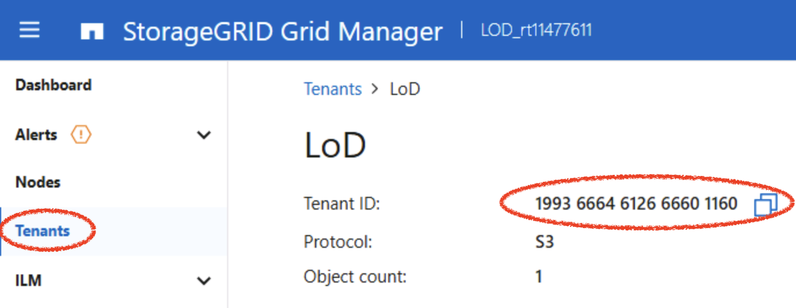
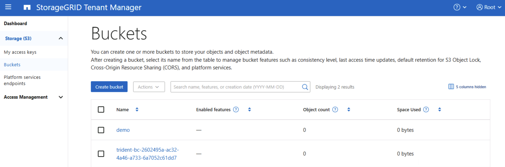

#########################################################################################
# COSI and StorageGRID
#########################################################################################

You will learn here how to configure Trident and Kubernetes to interact with StorageGrid.  

## A. Trident Object Store

In order to create a Trident Object Store for StorageGrid, you need 3 parameters:  
- `managementEndpoint`: https://192.168.0.80/
- `s3Endpoint`: https://dc1-adm1.demo.netapp.com:10443/
- `accountId`: Tenant ID

The lab already comes with a tenant ("LoD") configured and ready to be used.  
You can retrieve its ID by connecting to the Grid Manager (dc1-adm1.demo.netapp.com, root/Netapp1!) in the "Tenants" page:  
<p align="center"></p>

You can also retrieve that information via API calls:  
```bash
# 1. Get a token (single quotes stop bash from interpreting the "!" in the password)
TOKEN=$(curl -sk -X POST "https://dc1-adm1.demo.netapp.com/api/v4/authorize" \
  -H "accept: application/json" -H "Content-Type: application/json" \
  -d '{"username":"root","password":"Netapp1!","cookie":false,"csrfToken":false}' \
  | jq -r .data) && echo $TOKEN

# 2. List the tenant accounts
TENANTS=$(curl -sk -X GET "https://dc1-adm1.demo.netapp.com/api/v4/grid/accounts" -H "accept: application/json" -H "Authorization: Bearer $TOKEN") && echo $TENANTS

# 3. Retrieve the "Lod" Tenant id
TENANTID=$(echo $TENANTS | jq -r '.data[] | select(.name == "LoD") | .id') && echo $TENANTID
```

You can now proceed with the TOS creation (modify the _accountID_ parameter if needed), as well as the corresponding secret:  
```bash
cat << EOF | kubectl apply -f -
apiVersion: v1
kind: Secret
metadata:
  name: storagegrid
  namespace: trident
type: Opaque
stringData:
  username: root
  password: Netapp1!
---
apiVersion: trident.netapp.io/v1
kind: TridentObjectStore
metadata:
  name: storagegrid
  namespace: trident
spec:
  objectStoreDriver: storage-grid
  accountId: "$TENANTID"
  managementEndpoint: https://192.168.0.80/
  s3Endpoint: https://dc1-adm1.demo.netapp.com:10443/
  insecureSkipVerify: true
  credentials:
    secretName: storagegrid
  labels:
    performance: gold
EOF
```
If all went well, the TOS shoud be **online**:  
```bash
$ tridentctl get objectstore storagegrid -n trident
┌─────────────┬────────────────┬──────────────────────────────────────┬────────┐
│    NAME     │ STORAGE DRIVER │                 UUID                 │ STATE  │
├─────────────┼────────────────┼──────────────────────────────────────┼────────┤
│ storagegrid │ storage-grid   │ d22a13d1-7ff0-47d5-a911-a0d27d29a93c │ online │
└─────────────┴────────────────┴──────────────────────────────────────┴────────┘
```

## B. Kubernetes classes

You now need to create 2 classes, resources available for end users and applications:  
- the `BucketClass`: Defines how a bucket is provisioned on the backend, including the driver and the deletion policy, and is referenced by a `BucketClaim`.  
- the `BucketAccessClass`: Defines how access to a bucket is granted, including the driver and the authentication type (key or IAM), and is referenced by a `BucketAccess`.  
```bash
cat << EOF | kubectl apply -f -
apiVersion: objectstorage.k8s.io/v1alpha2
kind: BucketClass
metadata:
  name: sg-bucket-class
spec:
  driverName: cosi.trident.netapp.io
  deletionPolicy: Delete
  parameters:
    objectStoreType: "storage-grid"
    selector: "performance=gold"
---
apiVersion: objectstorage.k8s.io/v1alpha2
kind: BucketAccessClass
metadata:
  name: trident-s3-key
spec:
  driverName: cosi.trident.netapp.io
  authenticationType: Key
  multiBucketAccess: MultipleBuckets
EOF
```
A few notes about the `BucketClass`:  
- `deletionPolicy`: required parameter. However, a bucket can only be deleted if empty!  
- `parameters`: can be used to filter out the tenants you can use
- `multiBucketAccess`: specifies that a set of keys can be used for multiple BucketClaims  

## C. Bucket Creation

Now that everything is ready, you can proceed with the creation of a bucket with 2 specific resources:  
- `BucketClaim`: A namespaced request for a bucket. It references a `BucketClass`, and the COSI controller uses it to provision the bucket and bind it to a cluster-scoped `Bucket` object.
- `BucketAccess`: A namespaced request for credentials to one or more buckets. It references a `BucketAccessClass` and one or more `BucketClaims`. In _v1alpha2_, access can be set per bucket. The credentials are written to a Kubernetes Secret that the workload consumes.

Note that the BucketAccess also contains the name of the `accessSecretName` that contains the keys to connect to the bucket.  

Let's proceed with the creation of a bucket claim:  
```bash
cat << EOF | kubectl apply -f -
apiVersion: v1
kind: Namespace
metadata:
  name: cosisg
---
apiVersion: objectstorage.k8s.io/v1alpha2
kind: BucketClaim
metadata:
  name: sg-bucket-claim
  namespace: cosisg
spec:
  bucketClassName: sg-bucket-class
  protocols: ["S3"]
---
apiVersion: objectstorage.k8s.io/v1alpha2
kind: BucketAccess
metadata:
  name: sg-bucket-access
  namespace: cosisg
spec:
  bucketAccessClassName: trident-s3-key
  protocol: S3
  bucketClaims:
    - bucketClaimName: sg-bucket-claim
      accessMode: ReadWrite
      accessSecretName: sg-bucket-creds
EOF
```
As expected, this will also create a cluster scoped resource, called a bucket, which contains intesting informaiton, such as the bucket name:
```bash
$ kubectl get bucket "$(kubectl get bucketclaim sg-bucket-claim -n cosisg -o jsonpath='{.status.boundBucketName}')" -o json | jq .status
{
  "bucketID": "bc-2602495a-ac32-4a46-a733-6a7052c61dd7",
  "bucketInfo": {
    "COSI_S3_ADDRESSING_STYLE": "path",
    "COSI_S3_BUCKET_ID": "trident-bc-2602495a-ac32-4a46-a733-6a7052c61dd7",
    "COSI_S3_ENDPOINT": "https://dc1-adm1.demo.netapp.com:10443/",
    "COSI_S3_REGION": "us-east-1"
  },
  "protocols": [
    "S3"
  ],
  "readyToUse": true
}
```
The process also created a secret in the same namespace, that contains the keys to connect to the bucket:  
```bash
kubectl get secret sg-bucket-creds -n cosisg -o json | jq '.data | keys'
[
  "COSI_S3_ACCESS_KEY_ID",
  "COSI_S3_ACCESS_SECRET_KEY",
  "COSI_S3_ADDRESSING_STYLE",
  "COSI_S3_BUCKET_ID",
  "COSI_S3_ENDPOINT",
  "COSI_S3_REGION"
]
```
If you wanted to decode all of those fields at once:  
```bash
$ kubectl get secret sg-bucket-creds -n cosisg -o go-template='{{range $k,$v := .data}}{{printf "%s: %s\n" $k ($v | base64decode)}}{{end}}'
COSI_S3_ACCESS_KEY_ID: UOZX9D9HX9JMJBH6YHW2
COSI_S3_ACCESS_SECRET_KEY: nt/rXo8gm79Cnaizjv7QkuUeV11jfv+dkfubEHbZ
COSI_S3_ADDRESSING_STYLE: path
COSI_S3_BUCKET_ID: trident-bc-2602495a-ac32-4a46-a733-6a7052c61dd7
COSI_S3_ENDPOINT: https://dc1-adm1.demo.netapp.com:10443/
COSI_S3_REGION: us-east-1
```
To verify that the bucket is indeed there, you can connect to the Tenant Manager:  
<p align="center"></p>

You can also retrieve the list of buckets with the StorageGRID API:  
```bash
# 1. Get a token (single quotes stop bash from interpreting the "!" in the password)
$ TENANTTOKEN=$(curl -sk -X POST "https://dc1-adm1.demo.netapp.com/api/v4/authorize" \
  -H "accept: application/json" -H "Content-Type: application/json" \
  -d "{\"accountId\":\"$TENANTID\",\"username\":\"root\",\"password\":\"Netapp1\!\",\"cookie\":false,\"csrfToken\":false}" \
  | jq -r .data) && echo $TENANTTOKEN

# 2. List the bucket
$ curl -sk -X GET "https://dc1-adm1.demo.netapp.com/api/v4/org/containers" -H "accept: application/json" -H "Authorization: Bearer $TENANTTOKEN" | jq -r '.data[].name'
demo
trident-bc-2602495a-ac32-4a46-a733-6a7052c61dd7
```

## D. Bucket Consumption with aws-cli

We have a bucket, we have keys! Let's first try to interact with this bucket using the aws-cli tool to validate connectivity.  
We first need to configure the variables in the tool's configuration files:  
```bash
export SGBUCKETKEY=$(kubectl get secret sg-bucket-creds -n cosisg -o jsonpath='{.data.COSI_S3_ACCESS_KEY_ID}' | base64 -d)
export SGBUCKETSECRET=$(kubectl get secret sg-bucket-creds -n cosisg -o jsonpath='{.data.COSI_S3_ACCESS_SECRET_KEY}' | base64 -d)
export SGBUCKETID=$(kubectl get secret sg-bucket-creds -n cosisg  -o jsonpath='{.data.COSI_S3_BUCKET_ID}' | base64 -d)

cat << EOF >> .aws/config
[profile sg]
endpoint_url = https://dc1-adm1.demo.netapp.com:10443/
region = us-east-1
EOF

cat << EOF >> .aws/credentials
[sg]
aws_access_key_id = $SGBUCKETKEY
aws_secret_access_key = $SGBUCKETSECRET
EOF
```
To test connectivity, you can upload a file to the bucket, and read it:  
```bash
$ touch test.txt
$ aws s3 cp test.txt s3://$SGBUCKETID/test.txt --profile sg --no-verify-ssl
upload: ./test.txt to s3://trident-bc-2602495a-ac32-4a46-a733-6a7052c61dd7/test.txt

$ aws s3 ls s3://$SGBUCKETID/ --profile sg --no-verify-ssl
2026-11-01 08:16:55          0 test.txt
```

Note that because we use an insecure connection, you will see the following Python warning each time you run the aws command against your bucket:
```bash
urllib3/connectionpool.py:1097: InsecureRequestWarning: Unverified HTTPS request is being made to host 'dc1-adm1.demo.netapp.com'. Adding certificate verification is strongly advised. See: https://urllib3.readthedocs.io/en/latest/advanced-usage.html#tls-warnings
```
If you want to remove those messages, you can run the following in your session:  
```bash
aws() { command aws "$@" 2> >(grep -v InsecureRequestWarning >&2); }
```

Now that we have validated we can read & write from the bucket, let's try with a pod!

## E. Bucket Consumption in Kubernetes

This time, you will create a pod that mounts the secret containing all the bucket information:  
```bash
cat << EOF | kubectl apply -f -
apiVersion: v1
kind: Pod
metadata:
  name: sg-bucket-client
  namespace: cosisg
spec:
  restartPolicy: Never
  containers:
    - name: aws-cli
      image: amazon/aws-cli:latest
      command: ["sleep", "infinity"]
      envFrom:
        - secretRef:
            name: sg-bucket-creds          # COSI_S3_* variables
      env:
        - name: AWS_ACCESS_KEY_ID
          valueFrom:
            secretKeyRef:
              name: sg-bucket-creds
              key: COSI_S3_ACCESS_KEY_ID
        - name: AWS_SECRET_ACCESS_KEY
          valueFrom:
            secretKeyRef:
              name: sg-bucket-creds
              key: COSI_S3_ACCESS_SECRET_KEY
        - name: AWS_ENDPOINT_URL_S3
          valueFrom:
            secretKeyRef:
              name: sg-bucket-creds
              key: COSI_S3_ENDPOINT
        - name: AWS_DEFAULT_REGION
          value: us-east-1
      volumeMounts:
        - name: bucket-creds
          mountPath: /cosi
          readOnly: true
  volumes:
    - name: bucket-creds
      secret:
        secretName: sg-bucket-creds
EOF
```
Once ready, use the following to list the content of the bucket and add a new file:  
```bash
$ kubectl exec po/sg-bucket-client -n cosisg -- sh -c 'aws s3 ls --no-verify-ssl s3://$COSI_S3_BUCKET_ID/'
2026-11-01 13:16:55          0 test.txt

$ kubectl exec po/sg-bucket-client -n cosisg -- sh -c 'touch test2.txt && aws s3 cp test2.txt --no-verify-ssl s3://$COSI_S3_BUCKET_ID/'
upload: ./test2.txt to s3://trident-bc-2602495a-ac32-4a46-a733-6a7052c61dd7/test2.txt

$  kubectl exec po/sg-bucket-client -n cosisg -- sh -c 'aws s3 ls --no-verify-ssl s3://$COSI_S3_BUCKET_ID/'
2026-11-01 13:16:55          0 test.txt
2026-11-01 13:24:09          0 test2.txt
```

Tadaaa! Point validated!

## F. Sharing keys

In the configuration that is used here, there is only one bucket that is linked to one set of keys. As the parameter `multiBucketAccess`is set to _MultipleBuckets_, the same keys could be used by another bucket in the same namespace.  

However, a `BucketAccess` is immutable, so you need to know in advance how many buckets will shares the same keys. Deleting a BucketAccess and recreating one with references to 2 BucketClaims would generate new keys.  

Here is what the `BucketAccess` would like when created for 2 buckets:
```yaml
apiVersion: objectstorage.k8s.io/v1alpha2
kind: BucketAccess
metadata:
  name: sg-bucket-access-example
  namespace: cosisg
spec:
  bucketAccessClassName: trident-s3-key
  protocol: S3
  bucketClaims:
    - bucketClaimName: sg-bucket-claim-rw
      accessMode: ReadWrite
      accessSecretName: sg-bucket-creds
    - bucketClaimName: sg-bucket-claim-ro
      accessMode: ReadOnly
      accessSecretName: sg-bucket-creds
```

## G. Delete the bucket

A bucket can only be deleted when it is empty.  
Let's first remove all the files:  
```bash
$ kubectl exec po/sg-bucket-client -n cosisg -- sh -c 'aws s3 rm --no-verify-ssl s3://$COSI_S3_BUCKET_ID/ --recursive'
delete: s3://trident-bc-2602495a-ac32-4a46-a733-6a7052c61dd7/test.txt
delete: s3://trident-bc-2602495a-ac32-4a46-a733-6a7052c61dd7/test2.txt

$ kubectl exec po/sg-bucket-client -n cosisg -- sh -c 'aws s3 ls --no-verify-ssl s3://$COSI_S3_BUCKET_ID/ --summarize'
Total Objects: 0
   Total Size: 0
```
You can now proceed with the bucket deletion:  
```bash
kubectl delete bucketaccess sg-bucket-access -n cosisg
kubectl delete bucketclaim sg-bucket-claim -n cosisg
```
Validate in the UI that the bucket is gone, or by using the following API call:  
```bash
$ curl -sk -X GET "https://dc1-adm1.demo.netapp.com/api/v4/org/containers" -H "accept: application/json" -H "Authorization: Bearer $TENANTTOKEN" | jq -r '.data[].name'
demo
```
The bucket created by Trident is indeed gone.

This closes the first part of this chapter, you can now move to the COSI integration with ONTAP.