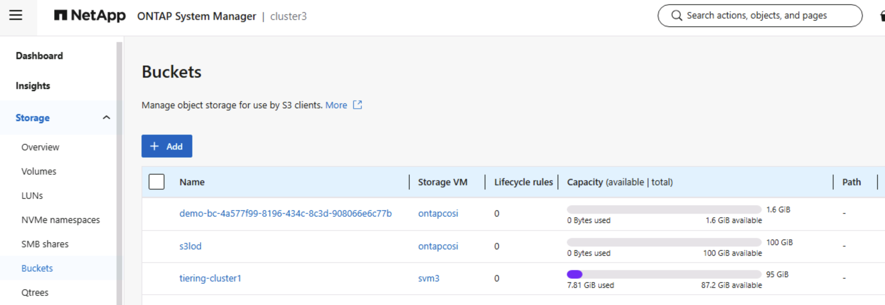

#########################################################################################
# COSI and ONTAP (**Tech Preview**)
#########################################################################################

You will learn here how to configure Trident and Kubernetes to interact with ONTAP.  

This lab already comes with a SVM with S3 enabled. You can use it, granted it needs some customization, or you can create a new one.

## A. ONTAP Setup

If you decide to use the existing SVM, you need to perform the following tasks:  
- create a Management LIF
- unlock the vsadmin user and set a password

This can all be achieved with the Ansible playbook _playbook-svm3-setup.yaml_:  
```bash
$ ansible-playbook playbook-svm3-setup.yaml
PLAY [SVM3 Customization] 
TASK [Gathering Facts] 
TASK [Configure SVM Mgmt Service Policy] 
TASK [Create Mgmt LIF] 
TASK [Unlock VSadmin] 
TASK [Rename interface] 
TASK [Rename interface] 
PLAY RECAP 
localhost                  : ok=6    changed=5    unreachable=0    failed=0    skipped=0    rescued=0    ignored=0
```

If you would like to create your own SVM for this test, you can use the _playbook-svmcosi-setup.yaml_ playbook:  
```bash
$ ansible-playbook playbook-svmcosi-setup.yaml | tee playbook-svmcosi-result.txt
PLAY [S3 Environment Creation]
TASK [Gathering Facts]
TASK [Create SVM]
TASK [Configure SVM Mgmt Service Policy]
TASK [Create Mgmt LIF]
TASK [Configure SVM Data Service Policy]
TASK [Create S3 Endpoint]
TASK [create SSL certificate for HTTPS]
TASK [create S3 service]
TASK [Unlock VSadmin]
TASK [Create S3 User]
TASK [Print ONTAP Response for S3 User create]
TASK [Create S3 bucket with a policy]
TASK [Add the ONTAP COSI S3 DNS record]
localhost                  : ok=14   changed=11   unreachable=0    failed=0    skipped=0    rescued=0    ignored=0
```
The ouput was also sent to a text file, as it contains keys for an additional bucket.

## B. Trident Object Store

You can now proceed with the TOS creation (modify the _accountID_ parameter if needed), as well as the corresponding secret:  
```bash
cat << EOF | kubectl apply -f -
apiVersion: v1
kind: Secret
metadata:
  name: ontap-s3-credentials
  namespace: trident
type: Opaque
stringData:
  username: vsadmin
  password: Netapp1!
---
apiVersion: trident.netapp.io/v1
kind: TridentObjectStore
metadata:
  name: cosi-ontap-s3
  namespace: trident
spec:
  objectStoreDriver: ontap-s3
  objectStoreName: ontap-s3
  managementEndpoint: 192.168.0.230     # change to 192.168.0.156 if you use the SVM3 environment
  svmName: ontapcosi                    # change to svm3 if using the other environment
  storagePrefix: demo
  credentials:
    secretName: ontap-s3-credentials
EOF
```

If all went well, the TOS shoud be **online**:  
```bash
$ tridentctl -n trident get objectstore cosi-ontap-s3
┌───────────────┬────────────────┬──────────────────────────────────────┬────────┐
│     NAME      │ STORAGE DRIVER │                 UUID                 │ STATE  │
├───────────────┼────────────────┼──────────────────────────────────────┼────────┤
│ cosi-ontap-s3 │ ontap-s3       │ f95a9baa-2970-4a53-a357-4b7dd7f9065f │ online │
└───────────────┴────────────────┴──────────────────────────────────────┴────────┘
```

## B. Kubernetes classes

You can now create a BucketClass, which filters on the Object Store type:
```bash
cat << EOF | kubectl apply -f -
apiVersion: objectstorage.k8s.io/v1alpha2
kind: BucketClass
metadata:
  name: ontap-bucket-class
spec:
  driverName: cosi.trident.netapp.io
  deletionPolicy: Delete
  parameters:
    objectStoreType: "ontap-s3"
EOF
```
If you have not configured the lab for StorageGRID, you probably also need to create the `BucketAccessClass`:
```bash
cat << EOF | kubectl apply -f -
apiVersion: objectstorage.k8s.io/v1alpha2
kind: BucketAccessClass
metadata:
  name: trident-s3-key
spec:
  driverName: cosi.trident.netapp.io
  authenticationType: Key
  multiBucketAccess: MultipleBuckets
EOF
```

## C. Bucket Creation

Time to create your first COSI bucket with ONTAP!  
The manifest is pretty similar to the one for StorageGRID, the difference being on the classes it refers to:  
```bash
cat << EOF | kubectl apply -f -
apiVersion: v1
kind: Namespace
metadata:
  name: cosiontap
---
apiVersion: objectstorage.k8s.io/v1alpha2
kind: BucketClaim
metadata:
  name: ontap-bucket-claim
  namespace: cosiontap
spec:
  bucketClassName: ontap-bucket-class
  protocols: ["S3"]
---
apiVersion: objectstorage.k8s.io/v1alpha2
kind: BucketAccess
metadata:
  name: ontap-bucket-access
  namespace: cosiontap
spec:
  bucketAccessClassName: trident-s3-key
  protocol: S3
  bucketClaims:
    - bucketClaimName: ontap-bucket-claim
      accessMode: ReadWrite
      accessSecretName: ontap-bucket-creds
EOF
```
As expected, this will also create a cluster scoped resource, called a bucket, which contains intesting informaiton, such as the bucket name:
```bash
$ kubectl get bucket "$(kubectl get bucketclaim ontap-bucket-claim -n cosiontap -o jsonpath='{.status.boundBucketName}')" -o json | jq .status
{
  "bucketID": "bc-4a577f99-8196-434c-8c3d-908066e6c77b",
  "bucketInfo": {
    "COSI_S3_ADDRESSING_STYLE": "path",
    "COSI_S3_BUCKET_ID": "demo-bc-4a577f99-8196-434c-8c3d-908066e6c77b",
    "COSI_S3_ENDPOINT": "https://ontapcosi.demo.netapp.com",
    "COSI_S3_REGION": "8ca35e9d-d6d7-11f1-8ff0-005056a4b01e"
  },
  "protocols": [
    "S3"
  ],
  "readyToUse": true
}
```
The process also created a secret in the same namespace, that contains the keys to connect to the bucket:  
```bash
$ kubectl get secret ontap-bucket-creds -n cosiontap -o json | jq '.data | keys'
[
  "COSI_S3_ACCESS_KEY_ID",
  "COSI_S3_ACCESS_SECRET_KEY",
  "COSI_S3_ADDRESSING_STYLE",
  "COSI_S3_BUCKET_ID",
  "COSI_S3_ENDPOINT",
  "COSI_S3_REGION"
]
```
If you wanted to decode all of those fields at once:  
```bash
$ kubectl get secret ontap-bucket-creds -n cosiontap -o go-template='{{range $k,$v := .data}}{{printf "%s: %s\n" $k ($v | base64decode)}}{{end}}'
COSI_S3_ACCESS_KEY_ID: R2HGJ321Z8P2P0TYQ52X
COSI_S3_ACCESS_SECRET_KEY: 9hy48369hXQTj8CT29BKiAjz6n19tLWg0pA7tZ_D
COSI_S3_ADDRESSING_STYLE: path
COSI_S3_BUCKET_ID: demo-bc-4a577f99-8196-434c-8c3d-908066e6c77b
COSI_S3_ENDPOINT: https://ontapcosi.demo.netapp.com
COSI_S3_REGION: 8ca35e9d-d6d7-11f1-8ff0-005056a4b01e
```
To verify that the bucket is indeed there, you can connect to System Manager: 
<p align="center"></p>

Or you can use an API Call to ONTAP to get list, and sort it by SVM
```bash
$ curl -s -X GET -ku admin:Netapp1! "https://cluster3.demo.netapp.com/api/protocols/s3/buckets" \
  | jq -r '.records | group_by(.svm.name)[] | "\(.[0].svm.name): \(map(.name) | join(", "))"'
ontapcosi: demo-bc-4a577f99-8196-434c-8c3d-908066e6c77b, s3lod
svm3: tiering-cluster1
```

The creation of the bucket was successful !

## D. Bucket Consumption with aws-cli

We have a bucket, we have keys! Let's first try to interact with this bucket using the aws-cli tool to validate connectivity.  
We first need to configure the variables in the tool's configuration files:  
```bash
export ONTAPBUCKETKEY=$(kubectl get secret ontap-bucket-creds -n cosiontap -o jsonpath='{.data.COSI_S3_ACCESS_KEY_ID}' | base64 -d)
export ONTAPBUCKETSECRET=$(kubectl get secret ontap-bucket-creds -n cosiontap -o jsonpath='{.data.COSI_S3_ACCESS_SECRET_KEY}' | base64 -d)
export ONTAPBUCKETID=$(kubectl get secret ontap-bucket-creds -n cosiontap -o jsonpath='{.data.COSI_S3_BUCKET_ID}' | base64 -d)
export ONTAPBUCKETREGION=$(kubectl get secret ontap-bucket-creds -n cosiontap -o jsonpath='{.data.COSI_S3_REGION}' | base64 -d)
export ONTAPBUCKETENDPOINT=$(kubectl get secret ontap-bucket-creds -n cosiontap -o jsonpath='{.data.COSI_S3_ENDPOINT}' | base64 -d)

cat << EOF >> .aws/config
[profile ontap]
endpoint_url = $ONTAPBUCKETENDPOINT
region = $ONTAPBUCKETREGION
request_checksum_calculation = when_required
response_checksum_validation = when_required
EOF

cat << EOF >> .aws/credentials
[ontap]
aws_access_key_id = $ONTAPBUCKETKEY
aws_secret_access_key = $ONTAPBUCKETSECRET
EOF
```
The two _checksum_ parameters in the config files are there so that ONTAP accepts the requests.  
The default value (*when_supported*) of the AWS-CLI tool adds a CRC-based checksum, which is rejected by ONTAP for PUT requests.  

To test connectivity, you can upload a file to the bucket, and read it:  
```bash
$ touch test.txt
$ aws s3 cp test.txt s3://$ONTAPBUCKETID/test.txt --profile ontap --no-verify-ssl
upload: ./test.txt to s3://demo-bc-4a577f99-8196-434c-8c3d-908066e6c77b/test.txt

$ aws s3 ls s3://$ONTAPBUCKETID/ --profile ontap --no-verify-ssl
2026-11-02 17:35:24          0 test.txt
```

Note that because we use an insecure connection, you will see the following Python warning each time you run the aws command against your bucket:
```bash
urllib3/connectionpool.py:1097: InsecureRequestWarning: Unverified HTTPS request is being made to host 'dc1-adm1.demo.netapp.com'. Adding certificate verification is strongly advised. See: https://urllib3.readthedocs.io/en/latest/advanced-usage.html#tls-warnings
```
If you want to remove those messages, you can run the following in your session:  
```bash
aws() { command aws "$@" 2> >(grep -v InsecureRequestWarning >&2); }
```

Now that we have validated we can read & write from the bucket, let's try with a pod!

## E. Bucket Consumption in Kubernetes

This time, you will create a pod that mounts the secret containing all the bucket information:  
```bash
cat << EOF | kubectl apply -f -
apiVersion: v1
kind: Pod
metadata:
  name: ontap-bucket-client
  namespace: cosiontap
spec:
  restartPolicy: Never
  containers:
    - name: aws-cli
      image: amazon/aws-cli:latest
      command: ["sleep", "infinity"]
      envFrom:
        - secretRef:
            name: ontap-bucket-creds          # COSI_S3_* variables
      env:
        - name: AWS_ACCESS_KEY_ID
          valueFrom:
            secretKeyRef:
              name: ontap-bucket-creds
              key: COSI_S3_ACCESS_KEY_ID
        - name: AWS_SECRET_ACCESS_KEY
          valueFrom:
            secretKeyRef:
              name: ontap-bucket-creds
              key: COSI_S3_ACCESS_SECRET_KEY
        - name: AWS_ENDPOINT_URL_S3
          valueFrom:
            secretKeyRef:
              name: ontap-bucket-creds
              key: COSI_S3_ENDPOINT
        - name: AWS_DEFAULT_REGION
          valueFrom:
            secretKeyRef:
              name: ontap-bucket-creds
              key: COSI_S3_REGION
        # Same effect as request/response_checksum_* = when_required in ~/.aws/config.
        # Default (when_supported) sends a CRC checksum trailer ONTAP rejects.
        - name: AWS_REQUEST_CHECKSUM_CALCULATION
          value: when_required
        - name: AWS_RESPONSE_CHECKSUM_VALIDATION
          value: when_required
      volumeMounts:
        - name: bucket-creds
          mountPath: /cosi
          readOnly: true
  volumes:
    - name: bucket-creds
      secret:
        secretName: ontap-bucket-creds
EOF
```
Once ready, use the following to list the content of the bucket and add a new file:  
```bash
$ kubectl exec po/ontap-bucket-client -n cosiontap -- sh -c 'aws s3 ls --no-verify-ssl s3://$COSI_S3_BUCKET_ID/'
2026-11-02 17:35:24          0 test.txt

$ kubectl exec po/ontap-bucket-client -n cosiontap -- sh -c 'touch test2.txt && aws s3 cp test2.txt --no-verify-ssl s3://$COSI_S3_BUCKET_ID/'
upload: ./test2.txt to s3://demo-bc-4a577f99-8196-434c-8c3d-908066e6c77b/test2.txt

$ kubectl exec po/ontap-bucket-client -n cosiontap -- sh -c 'aws s3 ls --no-verify-ssl s3://$COSI_S3_BUCKET_ID/'
2026-11-02 17:35:24          0 test.txt
2026-11-03 06:57:22          0 test2.txt
```

Once again, you validated how to use COSI with ONTAP S3.

## F. Delete the bucket

A bucket can only be deleted when it is empty.  
Let's first remove all the files:  
```bash
$ kubectl exec po/ontap-bucket-client -n cosiontap -- sh -c 'aws s3 rm --no-verify-ssl s3://$COSI_S3_BUCKET_ID/ --recursive'
delete: s3://demo-bc-4a577f99-8196-434c-8c3d-908066e6c77b/test.txt
delete: s3://demo-bc-4a577f99-8196-434c-8c3d-908066e6c77b/test2.txt

$ kubectl exec po/ontap-bucket-client -n cosiontap -- sh -c 'aws s3 ls --no-verify-ssl s3://$COSI_S3_BUCKET_ID/ --summarize'
Total Objects: 0
   Total Size: 0
```
You can now proceed with the bucket deletion:  
```bash
kubectl delete bucketaccess ontap-bucket-access -n cosiontap
kubectl delete bucketclaim ontap-bucket-claim -n cosiontap
```
Validate in the UI that the bucket is gone, or by using the following API call:  
```bash
$ curl -s -X GET -ku admin:Netapp1! "https://cluster3.demo.netapp.com/api/protocols/s3/buckets" \
  | jq -r '.records | group_by(.svm.name)[] | "\(.[0].svm.name): \(map(.name) | join(", "))"'
ontapcosi: s3lod
svm3: tiering-cluster1
```
The bucket created by Trident is indeed gone.

## G. Observations

If you created the SVM with the Ansible playbook, you may have noticed it also created a bucket.  
This triggered the creation of a FlexGroup consistuent that would later be used by the buckets created by Trident.  
For some reason (currently investigated), if there is no flexgroup, the creation of the bucket fails in the lab...